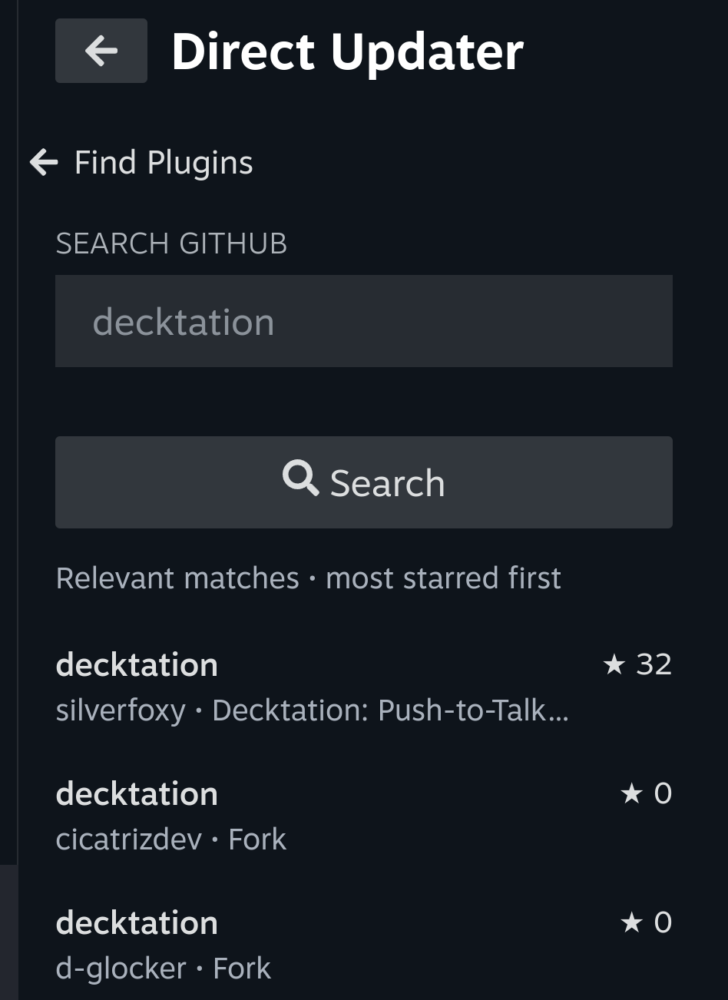
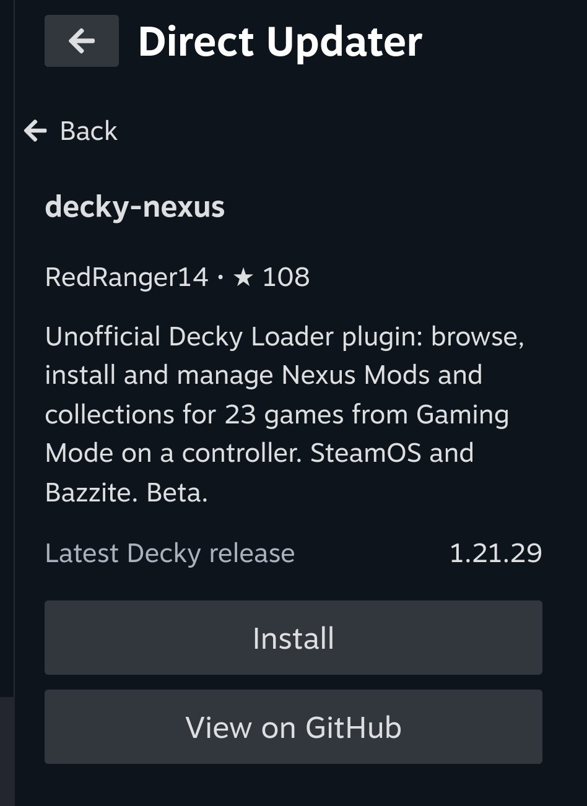
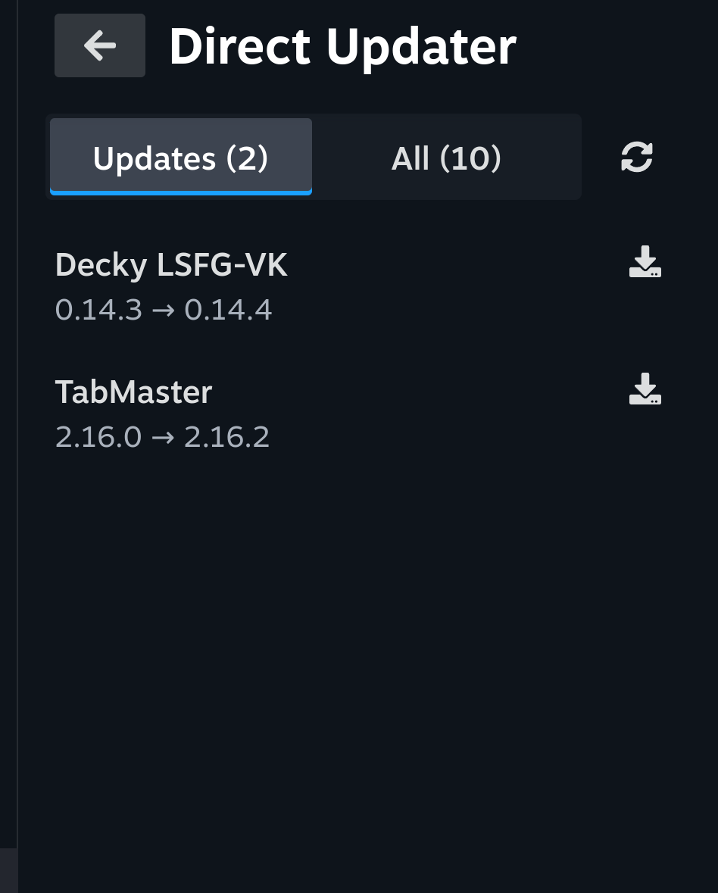
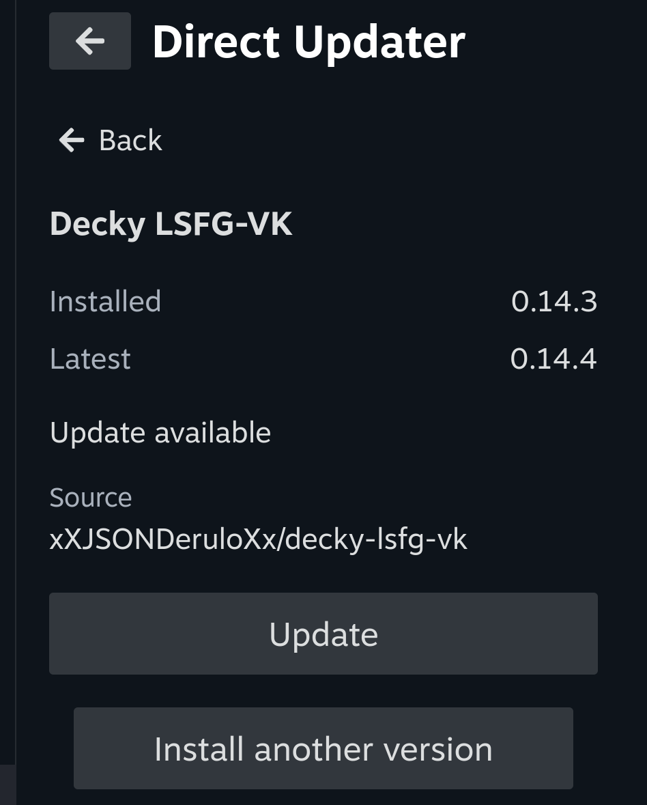

# Decky Direct Updater

Find and install Decky plugins from GitHub, and keep your installed plugins up to date.

## Install

Follow the [quick installation guide](https://deckyup.nukeador.com/). You need [Decky Loader](https://decky.xyz/) on your Steam Deck.

1. Open **Decky → Settings → General** and enable **Developer Mode**.
2. Open the **Developer** tab and install using either option:
   - **URL:** paste the address below into **Install Plugin from URL** and confirm.
   - **ZIP fallback:** [download the latest ZIP](https://github.com/nukeador/decky-direct-updater/releases/latest/download/Decky-Direct-Updater.zip), then select it with **Install Plugin from ZIP**.
3. Open **Direct Updater**. It finds your installed plugins and checks for updates automatically.

```text
https://deckyup.nukeador.com/install.zip
```

## Use it

- **Already installed plugins:** Direct Updater detects them and looks for their GitHub sources automatically. It asks you to review a source when needed.
- **Search icon (beside Refresh):** find a plugin by name, `owner/repo` or GitHub URL. Choose a result, check its release and select **Install**. Decky asks you to confirm.
- **Update available:** select the download icon beside the plugin, or open its details and choose **Update**. Decky asks you to confirm the installation.
- **Question mark:** the source needs your attention. Open it and choose **Use this source** for a suggested repository, or **Find source**. These plugins appear on the main screen, so you do not need to look in **All**.
- **Green dot on the Direct Updater icon:** a stable update is available. Checks run when the plugin loads and every four hours; you can also refresh manually.
- **Install another version:** choose a prerelease or an older version. Downgrades ask for an extra confirmation.

The website provides the initial installation; Direct Updater then checks for **its own updates**, so you only need the installation URL once. It never installs updates without your confirmation.

Plugins need a compatible ZIP release on GitHub. Plugins without one, such as SteamGridDB, should be updated through the Decky Store. Releases from developers may not have the Store's review.

## Find and install

Open the **search icon beside Refresh**, enter a plugin name or GitHub repository and press **Search**. Results show the author, description, stars and forks; **Show more** reveals more matches.

Choose a result to check its compatible release, then select **Install** and confirm in Decky. Already installed? Direct Updater shows **Update** or **Up to date** instead. Press **B** to return to your results.

Search can include projects that are not Decky plugins. Compatibility is checked when you open a result.

<p>
  
  
</p>

## Updates on Steam Deck

<p>
  
  
</p>

[Latest release](https://github.com/nukeador/decky-direct-updater/releases/latest) · [Testing and troubleshooting](docs/steam-deck-testing.md) · [Development](docs/development.md)

Independent community project, not affiliated with Decky Loader. [GNU AGPL v3 license](LICENSE).

Copyright © 2026 nukeador. Third-party code retains its own license notices.
